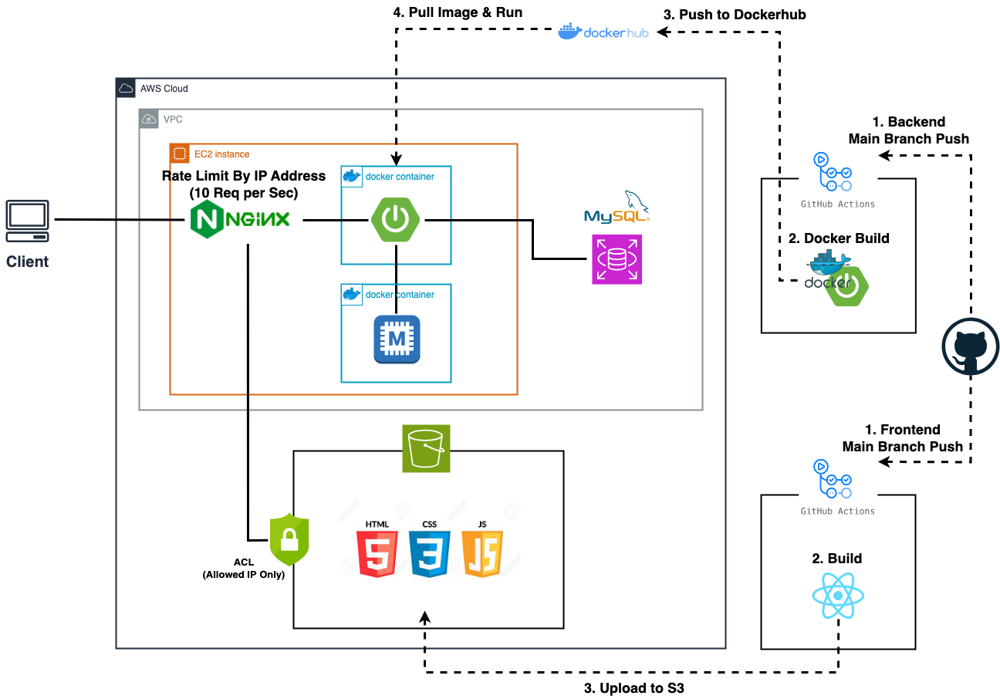

# Link Shortcut Server

## 기술 스택

- Java
- Spring Boot
- MySQL
- JPA / QueryDSL
- JUnit5 / Mockito
- Swagger
- Memcached
- Docker

<br />

## 프로젝트 실행

### 1. 로컬 환경 실행

#### 1-1. 환경 변수 설정 (1-1-1, 1-1-2 중 선택)

#### 1-1-1. resources-dev 디렉토리 내부에 application-env.yml 파일 생성

```yaml
BASE_URL: 서비스 URL (별도 설정이 없으면 http://localhost:8080)
DEV_DB_URL: DB URL
DEV_DB_USER: DB USER
DEV_DB_PW: DB PASSWORD 
```

#### 1-1-2. IntelliJ IDEA 실행 환경 변수 설정

- Run > Edit Configurations > Environment Variables 에 아래 형식으로 설정

```text
BASE_URL=서비스 URL;DEV_DB_URL=DB URL;DEV_DB_USER=DB USER;DEV_DB_PW=DB PASSWORD
```

#### 1-2. DB 테이블 생성

- application-dev.yml에서 auto-ddl을 create로 설정하고 1회 실행 후 원래대로 none으로 원복

```yaml
spring:
  jpa:
    hibernate:
      ddl-auto: create

...
```

#### 1-3. 서버 실행

- ApiApplication.java 실행

### 2. Docker 빌드 후 실행 (운영 환경)

#### 2-1. gradlew로 빌드 (docker 프로세스가 실행되어 있어야 함)

```shell
./gradlew -Pprofile=prod clean build

# 테스트 제외, docker 프로세스 실행할 수 없을시
./gradlew -Pprofile=prod -x test clean build 
```

#### 2-2. Docker 빌드

```shell
docker build -t link-shortcut-server .
```

#### 2-3. 환경 변수 설정

- 프로젝트 최상위 폴더에 .env 파일 생성

```text
BASE_URL=서비스 URL
PROD_DB_URL=DB URL
PROD_DB_USER=DB USER
PROD_DB_PW=DB PASSWORD
```

#### 2-4. Docker 실행

```shell
docker run --env-file=.env -d -p 8080:8080 link-shortcut-server
```

## CI/CD 환경 구축


<br />

- main branch에 push될 경우 Github Actions가 작동하여 CI/CD 작동
    1. Gradle 빌드 & 테스트 수행
    2. Docker 이미지 빌드
    3. Docker Hub에 이미지 업로드
    4. AWS EC2에 접속 후 Docker 이미지 다운로드
    5. 환경 변수 설정 후 Docker 컨테이너 실행

- API & 단축 URL 접속 요청시 NGINX를 통하여 서버로 라우팅

## API 명세

- 프로젝트 실행 후 http://localhost:8080/swagger-ui/index.html 에서 확인 가능